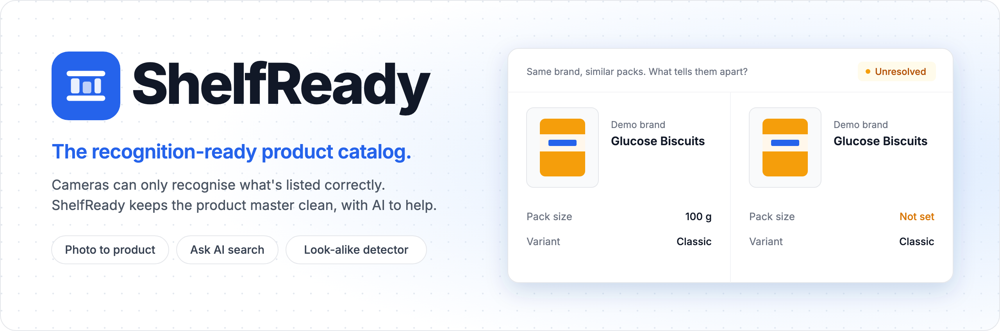

<p align="center">
  
</p>

<p align="center">
  <a href="https://shelf-ready.vercel.app"></a>
  <a href="https://github.com/eyekaushal/ShelfReady/actions/workflows/ci.yml"></a>
  <a href="LICENSE"></a>
  
  
  
  
</p>

A shelf-recognition camera can only recognise products that are listed **correctly** in the product master. Blurry reference photos, missing pack sizes, wrong barcodes, duplicates and look-alike variants (like *Parle-G 90 g vs 250 g*) are a common cause of misclassification on the shelf.

Think of a kirana shop owner's smart camera: it can only recognise what's written properly in the product notebook. **ShelfReady keeps that notebook clean.** It's a product catalog (SKU master) that sits *upstream* of a recognition system, with AI to fill in and search products. Its features are inspired by publicly described challenges in retail image recognition.

Built for the Infilect Full Stack Development Intern assignment, "Product Management & AI-Powered Search Platform".

## Live links

| | |
|---|---|
| **App** | https://shelf-ready.vercel.app |
| **API** | https://shelfready-api.onrender.com/api/ |
| **Swagger** | https://shelfready-api.onrender.com/api/docs/ |
| **Redoc** | https://shelfready-api.onrender.com/api/redoc/ |
| **Demo login** | `demo` / `ShelfReady@2026` (or **Use the demo account** on the sign-in page) |

The API runs on a free plan that sleeps when idle. A scheduled ping keeps it awake, but if you land on a sleeping server, the first load can take about a minute.

**A two-minute tour:**
1. On the catalog, click **Ask AI**, then an example such as *Cheapest noodles*. The sentence becomes removable filters.
2. Open **Look-alikes** to see same-brand products a camera could confuse.
3. Sign in, go to **Add product**, and use **Fill from photo** with a picture of any packet.

## Features

- **Auth:** register, login, refresh, logout, with JWT access and refresh tokens. Refresh tokens rotate and are blacklisted on logout.
- **Products:** create, read, update, delete. Anyone can read; only the creator or staff can change a product.
- **Search, filters, sorting, pagination:** across name, brand and description; by brand, category (including sub-categories) and price range. All of it is kept in the URL, so views can be shared.
- **Validation:** price above 0 with 2 decimals, http/https image URLs, length limits, GTIN check digit (GS1 mod-10), no duplicate GTINs. Every API error has the same shape:
  ```json
  { "error": { "code": "validation_error", "message": "Invalid input.", "details": { "price": ["Must be greater than 0."] } } }
  ```
- **AI:** photo → product form, natural-language search, description writer.
- **Look-alike SKU detector:** the add-on (see below).
- **UI states:** loading skeletons, empty and error states with retry, toasts, responsive layout.
- **Operations:** JSON logs, a request id on every response, one log line per AI call, Swagger docs, CI.

## Tech stack

| Area | Choice |
|---|---|
| Backend | Python 3.12, Django 5.2, Django REST Framework, simplejwt, django-filter, drf-spectacular |
| Database | PostgreSQL with pgvector and pg_trgm (Neon in production) |
| Frontend | React 19, Vite, plain JavaScript, Tailwind CSS, React Router, TanStack Query, axios |
| AI | Anthropic Claude: Sonnet 5.5 for reading photos, Haiku 5.5 for short text tasks |
| Images | Cloudinary (uploads and seed images), Pillow, imagehash |
| Background tasks | Celery + Redis locally; the same code runs inline in production |
| Hosting | Render (API), Vercel (frontend), Neon (database) |
| Tests and CI | pytest, ruff, oxlint, GitHub Actions |

## Local setup

### With Docker Compose (recommended)

You need Docker. An Anthropic key is optional: without one, AI buttons show "AI unavailable" and everything else works.

```bash
git clone https://github.com/eyekaushal/ShelfReady.git
cd ShelfReady
cp backend/.env.example backend/.env     # add ANTHROPIC_API_KEY here to use the AI features
docker compose up --build -d

docker compose exec backend python manage.py seed_catalog      # 141 products + the demo account
docker compose exec backend python manage.py analyze_catalog   # finds look-alikes
```

The first `analyze_catalog` downloads the images and a small embedding model, so it takes a few minutes.

- App: http://localhost:5173
- Swagger: http://localhost:8000/api/docs/
- Tests: `docker compose exec backend pytest`

To use photo uploads with permanent storage, also copy `frontend/.env.example` to `frontend/.env`, fill in the Cloudinary values, and run `docker compose up -d --force-recreate frontend`.

### Without Docker

You need Python 3.12, Node 22, and PostgreSQL with the pgvector extension. The simplest way to get that database is `docker compose up -d db redis`.

```bash
# Backend
cd backend
python3.12 -m venv .venv && source .venv/bin/activate
pip install -r requirements-dev.txt
cp .env.example .env
python manage.py migrate
python manage.py seed_catalog
python manage.py analyze_catalog
python manage.py runserver      # http://localhost:8000
pytest                          # in another terminal

# Frontend
cd frontend
cp .env.example .env
npm install
npm run dev                     # http://localhost:5173
```

## Environment variables

Secrets live only in environment variables. `backend/.env.example` and `frontend/.env.example` list everything.

**Backend**

| Variable | Purpose |
|---|---|
| `DJANGO_SECRET_KEY`, `DJANGO_DEBUG`, `DJANGO_ALLOWED_HOSTS` | Core Django settings |
| `DATABASE_URL` | Postgres connection (Neon in production) |
| `CORS_ALLOWED_ORIGINS`, `CSRF_TRUSTED_ORIGINS` | The frontend's address |
| `ANTHROPIC_API_KEY` | Empty = AI switched off cleanly |
| `ANTHROPIC_MODEL_VISION`, `ANTHROPIC_MODEL_FAST` | Claude models |
| `AI_TIMEOUT_SECONDS`, `IMAGE_FETCH_TIMEOUT_SECONDS` | Time limits |
| `THROTTLE_AUTH`, `THROTTLE_AI`, `THROTTLE_AI_SEARCH`, `THROTTLE_AI_GLOBAL` | Rate limits |
| `REDIS_URL`, `CELERY_TASK_ALWAYS_EAGER` | Background tasks. Eager = run inline |
| `EMBEDDINGS_ENABLED` | True = embedding model, False = `pg_trgm` |
| `LOOKALIKE_PHASH_MAX_DISTANCE`, `LOOKALIKE_TEXT_MIN_SIMILARITY`, `LOOKALIKE_TRIGRAM_MIN_SIMILARITY` | Look-alike thresholds |
| `SEED_DEMO_PASSWORD`, `LOG_LEVEL` | Demo account password, log level |

**Frontend:** `VITE_API_BASE_URL`, plus optional `VITE_CLOUDINARY_CLOUD_NAME` and `VITE_CLOUDINARY_UPLOAD_PRESET`.

## Deployment

- **Neon:** a Postgres database in Singapore. The `vector` and `pg_trgm` extensions are enabled by a Django migration, not by hand.
- **Render:** defined in [`render.yaml`](render.yaml). Gunicorn runs 1 worker with 4 threads and a 90-second timeout. Render's free plan has no shell, so [`backend/build.sh`](backend/build.sh) installs, collects static files, migrates, seeds and analyses on every deploy.
- **Vercel:** the root directory is `frontend`; [`vercel.json`](frontend/vercel.json) sends all routes to `index.html`.
- **Auto-deploy:** Render and Vercel both deploy when `main` changes.
- **Cold starts:** the free plan sleeps after 15 idle minutes. A GitHub Actions job pings `/api/health/` every 10 minutes. That endpoint skips the database, so Neon can still sleep and save its free hours.
- **Celery:** there's no paid worker in production, so `CELERY_TASK_ALWAYS_EAGER=True` runs the same task code inside the request.

## Key design decisions

- **Perceptual hash, not CLIP, for images.** CLIP has no free hosted API and is too heavy for a 512 MB server.
- **Local embeddings, with `pg_trgm` in production.** The embedding model peaked at about 320 MB when measured, on top of about 106 MB for the app. That's too close to the 512 MB limit, and it would load during a user's save. So production uses `pg_trgm`, which runs inside Postgres. One setting switches between them.
- **Celery only locally.** A paid worker isn't justified for a demo, and the task code is the same either way.
- **Cloudinary for images.** Pasting a URL always works. Uploads go straight from the browser to Cloudinary, so the API stores no files. The seed images were copied there too, because Open Food Facts took 4–25 seconds per image on first load.
- **JavaScript, not TypeScript.** It's the language this project's author knows best and can defend line by line.
- **Thin views, logic in service classes.** Views parse requests; classes such as `LookalikeService` and `ClaudeClient` hold the logic. One main class per backend file.
- **Permissions.** Anyone can read. Logged-in users can create. Only the creator or staff can edit or delete a product. Any logged-in user can review a look-alike pair, because that only records a decision.

## GenAI features

**1. Photo → product form** (`POST /api/ai/extract-product/`). Give it a pack photo by upload or URL. Claude reads the name, brand, category, variant, pack size, description and tags, with a confidence level per field. The form fills in with "AI-filled · review" badges, amber when the AI is unsure. **Nothing is saved until the user reviews it.** Price and barcode are never filled by AI.

**2. Natural-language search** (`POST /api/ai/parse-search/`). "Britannia biscuits under ₹50, cheapest first" becomes `{brand: "Britannia", category: "biscuits", max_price: 50, ordering: "price"}`. The filters appear as removable chips and go through the normal `GET /api/products/`, so there's only one search pipeline. If AI fails, it falls back to keyword search and says so.

**3. Description writer** (`POST /api/ai/generate-description/`). Name + brand + category → a short factual description and tags.

**Safety measures:**
- **The LLM never writes SQL or touches the database.** It only proposes data.
- **Everything it returns is validated.** A JSON schema shapes the answer, then a DRF serializer checks it, with one retry. Unknown keys are ignored.
- **AI search has a whitelist.** Brand and category must exist in the catalog, ordering must be an allowed value, and prices must be numbers ≥ 0. Anything else is dropped.
- **Text on packaging is treated as data, not instructions.**
- **Safe image fetching (SSRF protection).** http/https only, public addresses only, every redirect rechecked, 10-second and 5 MB limits, and Pillow confirms the file is really an image.
- **Rate limits.** 20 AI calls an hour per user, 30 AI searches an hour per user or IP, and a shared cap of 300 AI calls a day.
- **Graceful failure.** With no API key the app still works. Every AI call is logged (model, latency, tokens, outcome), but never the key or the image.

## Add-on: Look-alike SKU detector

**Why it matters for shelf recognition:** same-brand variants with nearly identical packaging are a hard case for a camera. The catalog has to record what tells them apart.

When a product is saved, it's compared with others of the same brand and top-level category. A pair is flagged if the photos look alike (perceptual hash) or the names read alike (text similarity). Then:
- If a filled-in pack size or variant differs, the pair is **Distinct** automatically.
- If not, it's an **Unresolved** twin. Filling in the missing attribute resolves it by itself.
- A reviewer can mark a pair as **Duplicate** or **Distinct**, and that decision is kept.

You'll find it on the **Look-alikes** page, in a **Possible look-alikes** box on product pages, and as a warning on the product form that doesn't block saving.

## Known limitations and what I'd do next

**Limitations**
- **Detection differs between local and production.** Embeddings run locally; `pg_trgm` runs on Render. They disagree on some pairs: Parle-G vs Parle-G Biscuit is flagged in production but not locally at the 0.90 threshold.
- **Photo matching is limited.** On the seed data, pHash only caught a near-identical photo. Names do most of the work, so real twins photographed differently rely on text.
- **Prices are illustrative.** Open Food Facts has no prices, so seed prices are estimated from pack size.
- **Seed data is messy on purpose, and resets.** It comes from crowd-sourced data. Each deploy restores the seed products, though products users add stay.
- **Per-IP rate limits can be dodged** by forging `X-Forwarded-For` on Render. That's why AI has a shared daily cap. The login limit has the same weakness.
- **Rate-limit counters and the AI search cache live in memory.** They reset on restart, and only suit one server process.
- **Saves are slower in production**, since analysis runs inside the request.
- **No undo on look-alike decisions** in the UI, and Ask AI can't answer stock questions because the catalog has no stock data.
- **Tokens are stored in localStorage**, which is simple but exposed to any script on the page.
- **The image check resolves the host before the request**, so a DNS server that changes its answer in between could slip past.
- **No frontend tests.** CI runs lint and build only.
- **Leftovers from dropped features:** an empty `imports` app and unused readiness columns on `Product`.

**Next**
- A recognition-readiness score for each product, with a catalog dashboard.
- Bulk import of messy brand spreadsheets, with AI column mapping.
- Change history, flagging products whose packaging changed.
- Hosting the embedding model where it fits, so production and local detect alike.
- Frontend tests, and Redis for rate limits and caching.

## Data and licence

Seed product data comes from [Open Food Facts](https://world.openfoodfacts.org) (database licence: [ODbL](https://opendatacommons.org/licenses/odbl/1-0/); images: [CC BY-SA](https://creativecommons.org/licenses/by-sa/3.0/)). Each seed product keeps its original image address in `source_image_url`. Product names and pack images belong to their respective owners and are used here only as demo data.

The code is under the [MIT licence](LICENSE).

Want the code walkthrough? See [ARCHITECTURE.md](ARCHITECTURE.md).
